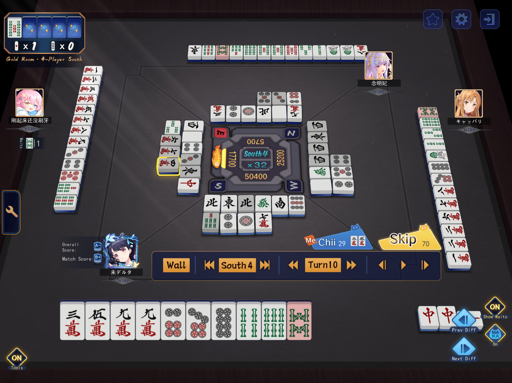

 <!-- photo-alt: C6984CAD-6526-4DA3-9E4C-E77D367FEDBF -->

Yes this gets tenpai but you don’t have a safe tile to discard, and the hand itself isn't valuable enough to be worth pushing against a riichi.
