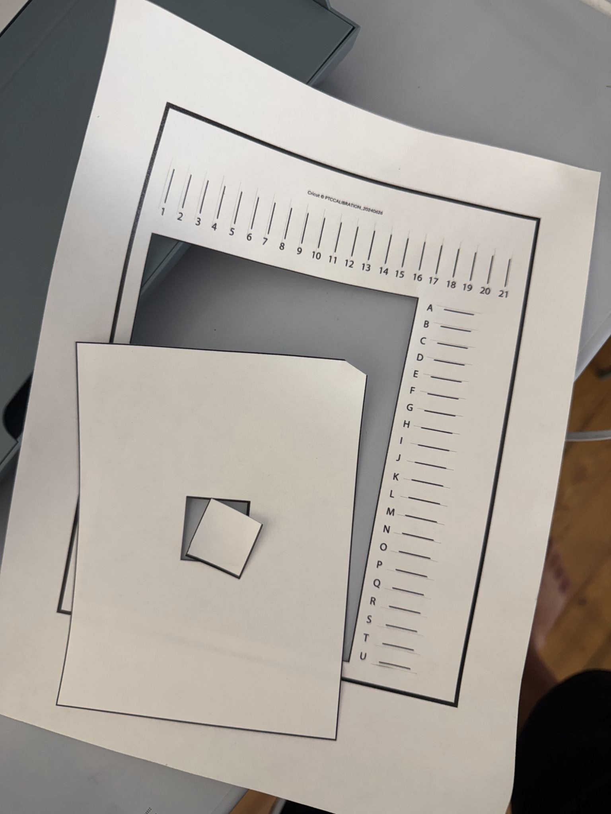

Cricut print then cut calibration greatly increased the accuracy of sticker cutting. It was off by 1-2mm before but now is accurate within 0.2mm which is accurate enough for my purposes.

I was able to print the calibration sheet with my eufyMake E1 after extracting it from the print queue (Cricut's software doesn't allow printing the calibration sheet via the system print dialogue).
