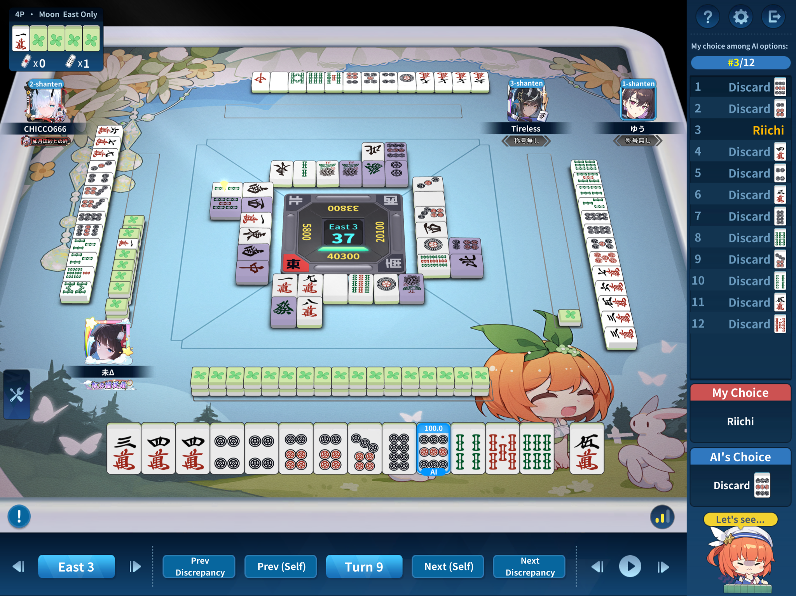

Perhaps no need to riichi here because already in first place? This is a bad wait riichi with only 1han. 2356m all improve this hand if we discard 9p, so there's a decent chance of getting a mangan+ hand if we wait a bit longer too.
